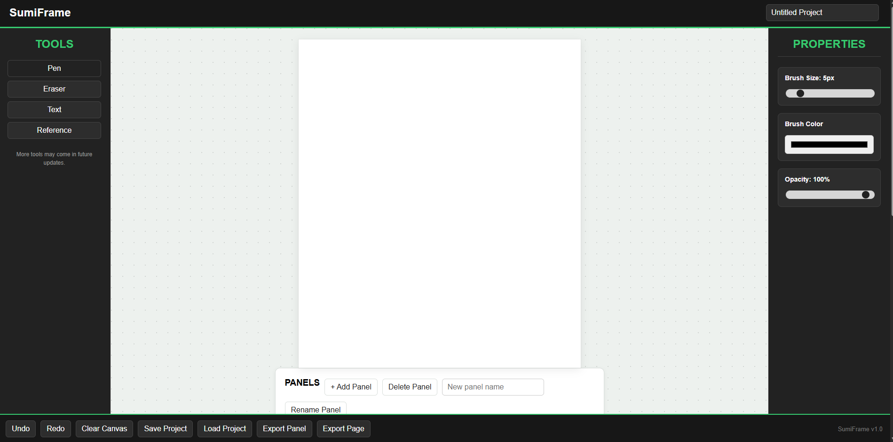
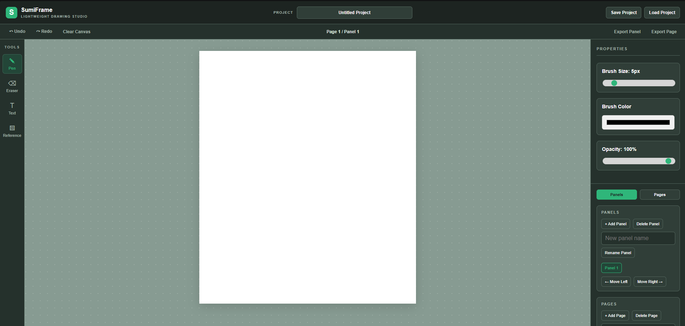
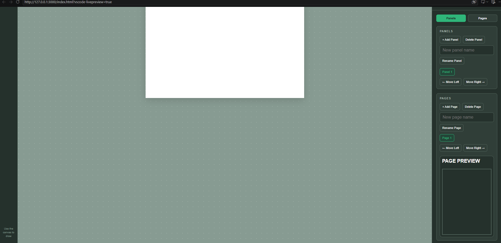

# SumiFrame

SumiFrame is a browser-based manga and storyboard editor I built using HTML, CSS, and JavaScript.

I wanted to create a simple workspace where users could draw, organize panels, manage pages, and save their projects without needing to install anything.

## Features

- Pen, eraser, and text tools
- Brush size, color, and opacity controls
- Reference image support
- Undo and redo
- Multiple panels per page
- Add, rename, delete, and reorder panels
- Multiple pages
- Add, rename, delete, and reorder pages
- Panels and Pages tabs
- Live page preview
- Save and load projects using JSON
- Export panels and full pages as PNG
- Custom project titles and export filenames

## Design

SumiFrame originally had a pretty basic interface. It worked, but I wanted something that looked cleaner and was easier to use.

For the redesign, I used Figma AI to generate an initial mockup. I liked the general direction, so I made some adjustments to the design and used it as a reference while updating the HTML and CSS.

I also added the Panels and Pages tabs using JavaScript and made sure the existing features still worked with the new layout.

## Before and After

Here's how SumiFrame changed throughout development.

### Original Version

This was the original interface before the redesign.

### Second Version

An earlier version of the updated interface.

### Current Version

The current interface with the updated layout, tools, and sidebar.

## Tech Stack

- HTML
- CSS
- JavaScript
- HTML Canvas API
- Figma / Figma AI

## What I Learned

Building SumiFrame gave me more practice with:

- Managing application data using arrays and objects
- Working with the HTML Canvas API
- Updating the interface with JavaScript
- Creating and managing DOM elements
- Event listeners and event delegation
- Undo and redo functionality
- Saving and loading data with JSON
- Exporting images from the browser
- Using CSS Grid and Flexbox
- Working from a Figma mockup
- Updating an existing interface without breaking its functionality

## Project Status

SumiFrame v1.0 is complete.

I may come back to add more drawing tools, page layouts, and other improvements in the future.

## Running Locally

Clone the repository and open `index.html` in your browser.

No installation is needed.

## Author

Built by Alex.
